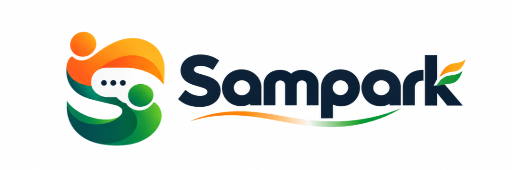
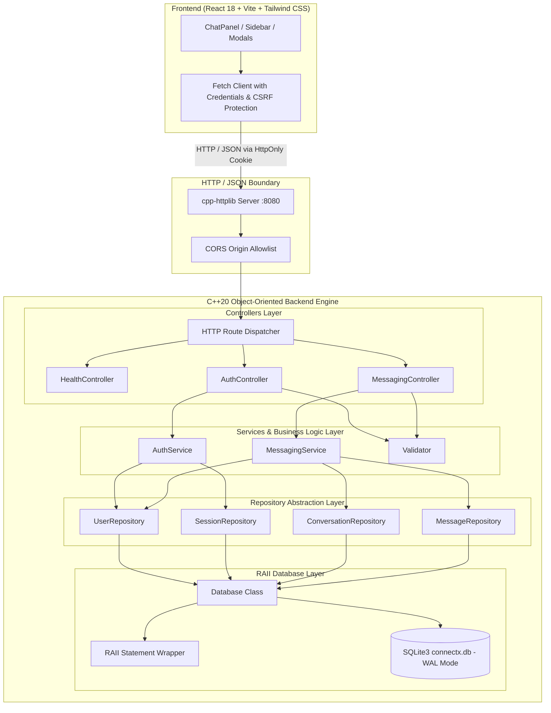

<div align="center">



# Sampark (सम्पर्क)
### High-Performance, Privacy-First Full-Stack Messaging Platform

[](https://en.cppreference.com/w/cpp/20)
[](https://react.dev/)
[](https://vitejs.dev/)
[](https://tailwindcss.com/)
[](https://www.sqlite.org/)
[](https://www.openssl.org/)
[](backend/tests/backend_test.cpp)
[](e2e_integration_test.ps1)

<p align="center">
  <b>Fast. Secure. Self-Contained.</b> Engineered with a bare-metal Object-Oriented C++ HTTP backend, atomic SQLite3 persistence, robust OpenSSL cryptography, and a responsive React frontend inspired by the Google Stitch Indian Tricolour design system.
</p>
</div>

---


## 📖 Table of Contents

1. [What is Sampark?](#-what-is-sampark)
2. [Key Features](#-key-features)
3. [Visual Identity & Design System](#-visual-identity--design-system)
4. [Full-Stack Architecture & OOP Principles](#-full-stack-architecture--oop-principles)
5. [Database Architecture & Schema](#-database-architecture--schema)
6. [REST API Reference](#-rest-api-reference)
7. [Getting Started & Local Setup](#-getting-started--local-setup)
8. [Automated Testing & Verification](#-automated-testing--verification)
9. [Project Directory Structure](#-project-directory-structure)
10. [Security & Cryptography Highlights](#-security--cryptography-highlights)
11. [License & Acknowledgments](#-license--acknowledgments)

---

## 🌟 What is Sampark?

**Sampark** (*सम्पर्क*, meaning *"connection"* or *"contact"* in Hindi) is a full-stack, production-grade messaging application designed to demonstrate that modern web platforms can achieve blazingly fast response times and rock-solid memory safety without sprawling microservice overhead.

Rather than relying on heavy application servers or managed cloud backends, Sampark combines:
- **Bare-metal C++20 Server:** Direct execution via `cpp-httplib` and OpenSSL with sub-millisecond route resolution.
- **Embedded SQLite3 Engine:** Thread-safe, non-destructive schema migrations, Write-Ahead Logging (WAL), and strict foreign key integrity.
- **WhatsApp Web-Style React Frontend:** Responsive in-place split-screen messaging, instant cursor polling, rich emoji interactions, quotes, and file sharing.
- **Google Stitch Tricolour Aesthetics:** An ergonomic color palette honoring the Indian Tricolour (Ashoka Chakra Navy, Saffron, and India Green) paired with complete dark mode ergonomics.

---

## 🚀 Key Features

### ⚡ Real-Time Messaging & Polling Sync
- **Deterministic 1-on-1 Chats:** Idempotent pair resolution (`user_low_id < user_high_id`) prevents duplicate channels.
- **Incremental Cursor Sync (`?after={lastMessageId}`):** Polling only fetches new deltas, avoiding full history refetches and minimizing network payload sizes.
- **Pagination (`?before={messageId}`):** Smoothly loads earlier message history as users scroll up.
- **Unread Message Badges & Auto-Mark-As-Read:** Instant read receipt synchronization (`POST /api/conversations/:id/read`).

### 👥 Group Chats & Member Management
- **Custom Group Creation:** Set group name, description, avatar, and select initial members (`POST /api/groups`).
- **Role-Based Permissions:** Granular `admin` and `member` roles. Only admins can add or remove members or edit group settings.
- **Sole Admin Protection:** Prevents the only administrator from demoting themselves, keeping groups properly managed.
- **Automatic Admin Succession:** When an admin departs a group, administrative privileges are automatically transferred to the oldest remaining member.
- **Group Disbanding:** Administrators can completely disband group chats (`DELETE /api/conversations/:id`).

### 💬 Rich Messaging Experience
- **Quoted Replies:** Reply directly to any message (`reply_to_id`) with cross-conversation validation, reply preview banners in the composer, and click-to-jump with glowing highlights.
- **Interactive Emoji Reactions:** Add and toggle emoji reactions (`👍`, `❤️`, `😂`, `🎉`, `🔥`, `🚀`) with live reaction counts and user list popovers.
- **In-Bar Emoji Picker:** Categorized emoji selector with instant search, category navigation, and cursor-accurate caret insertion (including cursor position `0`).
- **Author-Only Editing & Soft Deletion:** Edit messages with an `(edited)` indicator, or soft-delete with a tombstone marker (*"This message was deleted"*) to preserve thread continuity.
- **Search Capabilities:** Live search within a single conversation or global cross-conversation keyword search across all active chats.

### 📎 Hardened Attachment Engine
- **Strict Content Validation:** Magic-byte sniffing for JPEG (`FF D8 FF`), PNG (`89 50 4E 47`), GIF (`GIF87a`/`GIF89a`), WebP (`RIFF...WEBP`), PDF (`%PDF-`), DOCX (`PK\x03\x04`), DOC, and TXT.
- **Disguised Payload Detection:** Rejects binary files disguised as `.txt` by scanning for null bytes (`\0`) and invalid ASCII control characters.
- **10MB Enforced Limits:** Server-side request limits protect memory and disk storage.
- **Path Traversal Protection:** Strips directory separators, dots, and path traversal sequences (`../../etc/passwd`), storing files under randomized hex filenames (`<ts>_<uid>_<randHex>.<ext>`).
- **Access Control:** Validates user participation in conversations before permitting file downloads (`GET /api/attachments/:id`).
- **Unlinked Upload Deletion & Orphan Cleanup:** Users can delete unlinked uploads (`DELETE /api/attachments/:id`), and the server automatically cleans up orphaned temporary uploads.

### 🌓 Personalization & Dark Mode
- **Three Theme Modes:** Light, Dark, and System theme synchronizations persisted in SQLite (`user_preferences`).
- **Anti-FOUC Architecture:** Inline pre-hydration script eliminates Flash of Unstyled Content upon page load.
- **Audio Chimes:** Web Audio API notification sounds (`playNotificationChime`) for incoming and outgoing messages.
- **Desktop Notifications:** Native browser notifications with permission management.
- **Read Receipt Privacy Toggle:** Disable read receipts globally—suppressing read timestamps for both parties.

---

## 🎨 Visual Identity & Design System

Sampark's user interface is crafted around the **Google Stitch Indian Tricolour Design System**, balancing elegance, clarity, and national heritage:

| Color Token | Hex Code | Purpose |
|---|---|---|
| **Ashoka Chakra Navy** | `#0A1128` | Bedrock primary color for navigation, headings, primary buttons, and outgoing chat bubbles |
| **Saffron (Bhagwa)** | `#F58220` | Energy and attention anchor for notification badges, active thread highlights, and primary CTAs |
| **India Green** | `#138808` | Telemetry indicator for online presence, success banners, and verified security statuses |
| **Alabaster Surfaces** | `#FAFAF7` / `#F4F4F1` | Warm, expansive background surfaces that reduce eye fatigue |
| **Hairline Borders** | `#E7E9E4` | 1px clean framing separating sidebars, inputs, and conversation bubbles |

---

## 🏗️ Full-Stack Architecture & OOP Principles



### Key Software Engineering Principles
1. **Separation of Concerns:** Clean boundary separation between Controllers (HTTP deserialization & responses), Services (business rules & security), and Repositories (database CRUD).
2. **Interface Segregation & Dependency Inversion:** Pure virtual interfaces (`IUserRepository`, `ISessionRepository`, `IConversationRepository`, `IMessageRepository`, `IAuthService`, `IMessagingService`) allow dependency injection and modular unit testing.
3. **RAII Resource Management:** Database connections (`Database`) and prepared statements (`Statement`) follow Resource Acquisition Is Initialization, eliminating resource and memory leaks.
4. **Parameterized SQL:** Every query utilizes `sqlite3_bind_*` with zero untrusted string concatenation, providing immunity against SQL injection.
5. **Thread Safety & WAL:** Database operations are synchronized using `std::mutex` with SQLite configured in Write-Ahead Logging (`WAL`) mode for concurrent readers.

---

## 💾 Database Architecture & Schema

Sampark manages 8 interconnected tables with automatic schema migrations:

```
┌───────────────┐        ┌──────────────────────┐        ┌───────────────────────┐
│     users     │───┬───<│  conversation_members│>───┬───│     conversations     │
└───────────────┘   │    └──────────────────────┘    │    └───────────────────────┘
        │           │                                │                │
        │           │    ┌──────────────────────┐    │                │
        ├───────────┼───<│       messages       │>───┼────────────────┘
        │           │    └──────────────────────┘    │
        │           │                │               │
        │           │    ┌───────────┴──────────┐    │
        │           └───<│  message_reactions   │    │
        │                └──────────────────────┘    │
        │                ┌──────────────────────┐    │
        ├───────────────<│     attachments      │>───┘
        │                └──────────────────────┘
        │                ┌──────────────────────┐
        ├───────────────<│       sessions       │
        │                └──────────────────────┘
        │                ┌──────────────────────┐
        └───────────────<│   user_preferences   │
                         └──────────────────────┘
```

### Table Definitions

<details>
<summary><b>Click to expand full SQL Table Definitions</b></summary>

```sql
-- 1. Users Table
CREATE TABLE IF NOT EXISTS users (
    id INTEGER PRIMARY KEY AUTOINCREMENT,
    username TEXT UNIQUE NOT NULL COLLATE NOCASE,
    email TEXT UNIQUE NOT NULL COLLATE NOCASE,
    full_name TEXT NOT NULL,
    bio TEXT NOT NULL DEFAULT '',
    password_hash TEXT NOT NULL,
    salt TEXT NOT NULL,
    last_active_at TEXT NOT NULL DEFAULT '',
    created_at TEXT NOT NULL DEFAULT (datetime('now')),
    updated_at TEXT NOT NULL DEFAULT (datetime('now'))
);
CREATE INDEX IF NOT EXISTS idx_users_username ON users(username);
CREATE INDEX IF NOT EXISTS idx_users_email ON users(email);

-- 2. Sessions Table
CREATE TABLE IF NOT EXISTS sessions (
    token TEXT PRIMARY KEY,
    user_id INTEGER NOT NULL REFERENCES users(id) ON DELETE CASCADE,
    created_at TEXT NOT NULL DEFAULT (datetime('now')),
    expires_at TEXT NOT NULL
);
CREATE INDEX IF NOT EXISTS idx_sessions_token ON sessions(token);
CREATE INDEX IF NOT EXISTS idx_sessions_user_id ON sessions(user_id);

-- 3. Conversations Table (Direct & Group)
CREATE TABLE IF NOT EXISTS conversations (
    id INTEGER PRIMARY KEY AUTOINCREMENT,
    type TEXT NOT NULL DEFAULT 'direct',      -- 'direct' or 'group'
    name TEXT NOT NULL DEFAULT '',            -- Group title
    description TEXT NOT NULL DEFAULT '',     -- Optional group topic
    avatar_url TEXT NOT NULL DEFAULT '',      -- Optional avatar
    created_by INTEGER REFERENCES users(id) ON DELETE SET NULL,
    user_low_id INTEGER REFERENCES users(id) ON DELETE CASCADE,
    user_high_id INTEGER REFERENCES users(id) ON DELETE CASCADE,
    created_at TEXT NOT NULL DEFAULT (datetime('now')),
    updated_at TEXT NOT NULL DEFAULT (datetime('now')),
    CHECK (
        (type = 'direct' AND user_low_id IS NOT NULL AND user_high_id IS NOT NULL AND user_low_id < user_high_id)
        OR (type = 'group' AND name != '')
    )
);
CREATE UNIQUE INDEX IF NOT EXISTS idx_conv_direct_pair 
    ON conversations(user_low_id, user_high_id) 
    WHERE type = 'direct';

-- 4. Conversation Members Table
CREATE TABLE IF NOT EXISTS conversation_members (
    conversation_id INTEGER NOT NULL REFERENCES conversations(id) ON DELETE CASCADE,
    user_id INTEGER NOT NULL REFERENCES users(id) ON DELETE CASCADE,
    role TEXT NOT NULL DEFAULT 'member',     -- 'admin' or 'member'
    joined_at TEXT NOT NULL DEFAULT (datetime('now')),
    last_read_message_id INTEGER DEFAULT 0,  -- Per-member unread tracking
    PRIMARY KEY (conversation_id, user_id)
);

-- 5. Messages Table
CREATE TABLE IF NOT EXISTS messages (
    id INTEGER PRIMARY KEY AUTOINCREMENT,
    conversation_id INTEGER NOT NULL REFERENCES conversations(id) ON DELETE CASCADE,
    sender_id INTEGER NOT NULL REFERENCES users(id) ON DELETE CASCADE,
    body TEXT NOT NULL,
    reply_to_id INTEGER REFERENCES messages(id) ON DELETE SET NULL,
    created_at TEXT NOT NULL DEFAULT (datetime('now')),
    read_at TEXT DEFAULT NULL,
    edited_at TEXT DEFAULT NULL,
    is_deleted INTEGER NOT NULL DEFAULT 0
);
CREATE INDEX IF NOT EXISTS idx_messages_conv_created ON messages(conversation_id, created_at ASC);
CREATE INDEX IF NOT EXISTS idx_messages_unread ON messages(conversation_id, read_at, sender_id);
CREATE INDEX IF NOT EXISTS idx_messages_reply_to ON messages(reply_to_id);

-- 6. Message Reactions Table
CREATE TABLE IF NOT EXISTS message_reactions (
    id INTEGER PRIMARY KEY AUTOINCREMENT,
    message_id INTEGER NOT NULL REFERENCES messages(id) ON DELETE CASCADE,
    user_id INTEGER NOT NULL REFERENCES users(id) ON DELETE CASCADE,
    emoji TEXT NOT NULL,
    created_at TEXT NOT NULL DEFAULT (datetime('now')),
    UNIQUE(message_id, user_id, emoji)
);
CREATE INDEX IF NOT EXISTS idx_reactions_message ON message_reactions(message_id);

-- 7. File Attachments Table
CREATE TABLE IF NOT EXISTS attachments (
    id INTEGER PRIMARY KEY AUTOINCREMENT,
    conversation_id INTEGER NOT NULL REFERENCES conversations(id) ON DELETE CASCADE,
    uploader_id INTEGER NOT NULL REFERENCES users(id) ON DELETE CASCADE,
    message_id INTEGER REFERENCES messages(id) ON DELETE SET NULL,
    file_name TEXT NOT NULL,                  -- Display filename
    file_path TEXT NOT NULL,                  -- Safe server-side disk storage path
    file_size INTEGER NOT NULL,
    mime_type TEXT NOT NULL,
    created_at TEXT NOT NULL DEFAULT (datetime('now'))
);
CREATE INDEX IF NOT EXISTS idx_attachments_conv ON attachments(conversation_id);
CREATE INDEX IF NOT EXISTS idx_attachments_msg ON attachments(message_id);

-- 8. User Preferences Table
CREATE TABLE IF NOT EXISTS user_preferences (
    user_id INTEGER PRIMARY KEY REFERENCES users(id) ON DELETE CASCADE,
    theme TEXT NOT NULL DEFAULT 'system',    -- 'light', 'dark', 'system'
    sound_notifications INTEGER NOT NULL DEFAULT 1,
    desktop_notifications INTEGER NOT NULL DEFAULT 0,
    read_receipts_enabled INTEGER NOT NULL DEFAULT 1,
    updated_at TEXT NOT NULL DEFAULT (datetime('now'))
);
```
</details>

---

## 📡 REST API Reference

All requests and responses use JSON (`application/json`). Authentication is handled securely through `HttpOnly`, `SameSite=Lax` session cookies.

### 1. Health & Diagnostics
| Method | Endpoint | Description | Auth Required |
|---|---|---|---|
| `GET` | `/api/health` | Server heartbeat and system status | No |

### 2. Authentication & User Profiles
| Method | Endpoint | Description | Auth Required | Payload |
|---|---|---|---|---|
| `POST` | `/api/auth/register` | Create account & authenticate session | No | `{ username, email, fullName, password }` |
| `POST` | `/api/auth/login` | Log into account via username or email | No | `{ identifier, password }` |
| `POST` | `/api/auth/logout` | Terminate session & clear cookies | No | None |
| `GET` | `/api/auth/me` | Fetch currently logged-in user profile | **Yes** | None |
| `PUT` | `/api/auth/password` | Change user password | **Yes** | `{ currentPassword, newPassword }` |
| `GET` | `/api/users` | Discover registered members (`?q=`) | **Yes** | None |
| `GET` | `/api/users/:id` | View peer profile, bio, and presence | **Yes** | None |
| `PUT` | `/api/users/profile` | Update user display name and bio | **Yes** | `{ fullName, bio }` |

### 3. Conversations & Messaging
| Method | Endpoint | Description | Auth Required | Payload |
|---|---|---|---|---|
| `POST` | `/api/conversations` | Create or get direct conversation | **Yes** | `{ participantId }` |
| `GET` | `/api/conversations` | List user conversations with last message | **Yes** | None |
| `GET` | `/api/conversations/:id` | Get metadata for a conversation | **Yes** | None |
| `GET` | `/api/conversations/:id/messages` | Message history (`?after=`, `?before=`) | **Yes** | None |
| `POST` | `/api/conversations/:id/messages` | Send message (supports reply and attachment) | **Yes** | `{ body, replyToId?, attachmentId? }` |
| `POST` | `/api/conversations/:id/read` | Mark all unread messages as read | **Yes** | None |
| `PUT` | `/api/messages/:id` | Edit message (author only) | **Yes** | `{ body }` |
| `DELETE` | `/api/messages/:id` | Soft-delete message (author only) | **Yes** | None |
| `POST` | `/api/messages/:id/reactions` | Toggle emoji reaction on message | **Yes** | `{ emoji }` |
| `GET` | `/api/conversations/:id/messages/search` | Search messages within a conversation | **Yes** | Query `?q=` |
| `GET` | `/api/messages/search` | Global cross-conversation message search | **Yes** | Query `?q=` |

### 4. Group Management
| Method | Endpoint | Description | Auth Required | Payload |
|---|---|---|---|---|
| `POST` | `/api/groups` | Create group chat with initial members | **Yes** | `{ name, description, memberIds }` |
| `GET` | `/api/conversations/:id/members` | List group members and their roles | **Yes** | None |
| `POST` | `/api/conversations/:id/members` | Add member to group (admin only) | **Yes** | `{ userId }` |
| `DELETE` | `/api/conversations/:id/members/:userId` | Remove member from group (admin only) | **Yes** | None |
| `PUT` | `/api/conversations/:id/members/:userId` | Promote/demote role (`admin`/`member`) | **Yes** | `{ role }` |
| `POST` | `/api/conversations/:id/leave` | Leave group (auto-transfers admin) | **Yes** | None |
| `PUT` | `/api/conversations/:id` | Update group name/description (admin only)| **Yes** | `{ name, description }` |
| `DELETE` | `/api/conversations/:id` | Disband group entirely (admin only) | **Yes** | None |

### 5. File Attachments
| Method | Endpoint | Description | Auth Required | Payload |
|---|---|---|---|---|
| `POST` | `/api/conversations/:id/attachments` | Upload file (magic-byte checked, max 10MB) | **Yes** | Multipart or raw binary |
| `GET` | `/api/attachments/:id` | Download attachment (participants only) | **Yes** | None |
| `DELETE` | `/api/attachments/:id` | Cancel/delete unlinked attachment | **Yes** | None |

### 6. User Preferences
| Method | Endpoint | Description | Auth Required | Payload |
|---|---|---|---|---|
| `GET` | `/api/users/preferences` | Retrieve user preferences | **Yes** | None |
| `PUT` | `/api/users/preferences` | Update theme, audio, and read receipts | **Yes** | `{ theme, soundNotifications, ... }` |

---

## 💻 Getting Started & Local Setup

### System Prerequisites
- **C++ Compiler:** GCC or Clang supporting **C++20** (e.g. GCC 11+ on Linux/WSL, or MSYS2 UCRT64 GCC on Windows).
- **C++ Libraries:** `sqlite3`, `libssl`, `libcrypto`, `pthread` (Linux/WSL) or `ws2_32`, `crypt32` (Windows).
- **Node.js & npm:** Node.js v18+ (tested on Node.js v22).
- **Make:** Standard GNU `make` or `mingw32-make`.

---

### Option 1: One-Click Development Launch (Windows / PowerShell)

If you are on Windows, the repository includes a self-bootstrapping PowerShell script that builds the backend, starts the C++ server on port 8080, and launches the Vite frontend:

```powershell
.\start.ps1
```

Once launched, visit **`http://localhost:5173`** in your browser. Press `Ctrl+C` to cleanly terminate both processes.

---

### Option 2: Manual Multi-Platform Setup

#### 1. Clone the Repository
```bash
git clone https://github.com/Sujalkan07/Sampark.git
cd Sampark
```

#### 2. Build and Run the C++ Backend

> [!TIP]
> **Windows Users with WDAC/AppLocker:** Modern Windows operating systems often enforce Application Control policies blocking executable binaries in user directories. Compiling and running through **WSL (Ubuntu)** is the recommended path.

**On Linux / WSL (Ubuntu) / macOS:**
```bash
cd backend
make server
./server 0.0.0.0 8080 connectx.db
```

**On Windows (MSYS2 MinGW-w64):**
```bash
cd backend
mingw32-make server.exe
.\server.exe 127.0.0.1 8080 connectx.db
```

The C++ backend will launch on `http://127.0.0.1:8080` and automatically initialize or upgrade `connectx.db`.

#### 3. Build and Run the React Frontend

In a separate terminal window:
```bash
cd frontend
npm install
npm run dev
```

Open **`http://localhost:5173`** in your browser. All API requests made to `/api/*` are automatically proxied to the C++ server running on `http://localhost:8080` by Vite.

---

## 🧪 Automated Testing & Verification

Sampark includes two comprehensive automated test suites covering unit logic, cryptographic guarantees, and end-to-end HTTP integration:

### 1. Backend C++ Unit & Integration Test Suite (75 Tests)

The backend test suite verifies:
- Database initialization, foreign key constraints, and idempotent migrations
- Input validators, email regex, username formats, and bio constraints
- PBKDF2-HMAC-SHA256 password hashing with unique salts
- SQL injection immunity across user discovery, authentication, and search
- Multi-user session isolation and concurrent session revocation on password change
- Direct conversation normalization and chronological message pagination
- Incremental polling delta queries (`?after=`) and unread count accuracy
- Message editing, tombstone soft deletions, and cross-chat search
- Group chats: creation, member management, sole admin protection, and auto-admin transfer
- Message replies: quote linking, preview extraction, and cross-conversation rejection
- Emoji reactions: toggle, user aggregation, and tombstone isolation
- File attachments: magic-byte sniffing (JPEG, PNG, GIF, WebP, PDF, DOCX, DOC, TXT), binary-in-text detection, 10MB limits, directory traversal sanitization, random storage names, access controls, unlinked deletion, and reuse prevention
- User preferences: theme allowlist, notification flags, and read receipt privacy suppression
- Read receipts toggle lifecycle: permanent suppression of `read_at` timestamps so subsequent re-enabling never leaks read intervals
- Conversation type integrity: rejection of group operations on direct conversations with HTTP 400
- Group lifecycle integrity: sole admin demotion protection for all admins, atomic admin transfer, and auto-disband upon last member departure
- SQLite schema migration from legacy schemas with zero data loss and clean `PRAGMA foreign_key_check`

**Run Backend Tests:**
```bash
cd backend
make test

# Or on Windows via WSL:
wsl -d Ubuntu --cd backend make test
```
**Output:**
```
=============================================
 ALL 75 BACKEND TESTS PASSED SUCCESSFULLY!   
=============================================
```

---

### 2. End-to-End HTTP API Integration Test Suite (26 Multi-Step Tests)

The end-to-end integration test spawns a fresh live C++ server instance on a dedicated port (`8085`) and executes real HTTP calls across the entire network boundary:
- Health check and CORS preflight verification (accepts trusted origins, rejects `403 Forbidden` for untrusted origins)
- Multi-user registration, session cookies, and user discovery
- Direct messaging, history retrieval, and read receipt sync
- Profile bio update and character limits
- Group creation, member queries, and group messaging
- Message replies and emoji reaction toggles
- Attachment upload, magic-byte inspection, and authorized downloads
- User preferences updates and group disbanding

**Run E2E Tests:**
```powershell
powershell -ExecutionPolicy Bypass -File .\e2e_integration_test.ps1
```
**Output:**
```
===============================================
 ALL 26 END-TO-END HTTP TESTS PASSED 100%!     
===============================================
```

---

### 3. Frontend Production Build

Verify frontend compilation and asset bundling:
```bash
cd frontend
npm run build
```
**Output:**
```
✓ built in 1.62s
dist/index.html                   1.93 kB
dist/assets/index.css            45.15 kB
dist/assets/index.js            325.66 kB
```

---

## 📁 Project Directory Structure

```
Sampark/
├── .github/
│   └── workflows/
│       └── ci.yml                       # Automated CI: C++ build, 75 unit tests & React build
├── backend/                             # C++20 Backend Engine
│   ├── Makefile                         # Cross-platform GNU Makefile (Linux/Windows)
│   ├── include/                         # Header files and interfaces
│   │   ├── AuthController.hpp           # Auth and profile HTTP routing
│   │   ├── AuthService.hpp              # Authentication & password cryptography
│   │   ├── ConversationRepository.hpp   # Direct & group conversation persistence
│   │   ├── Database.hpp                 # RAII SQLite connection & migrations
│   │   ├── HealthController.hpp         # System health endpoint
│   │   ├── MessageRepository.hpp        # Message, reaction & attachment storage
│   │   ├── MessagingController.hpp      # Chat, group, reaction & upload routing
│   │   ├── MessagingService.hpp         # Messaging authorization & business logic
│   │   ├── Models.hpp                   # Domain entities and data structures
│   │   ├── Server.hpp                   # HTTP server routing and CORS handling
│   │   ├── SessionRepository.hpp        # Session tokens & cookie lifecycle
│   │   ├── UserRepository.hpp           # User CRUD & activity presence
│   │   ├── Validator.hpp                # Input & magic-byte attachment validation
│   │   ├── httplib.h                    # Embedded cpp-httplib header
│   │   └── nlohmann/                    # Third-party JSON library directory
│   │       └── json.hpp                 # Modern JSON for C++
│   ├── src/                             # Source implementations (.cpp)
│   │   ├── AuthController.cpp           # Route handlers for auth & profile
│   │   ├── AuthService.cpp              # Cryptographic hashing & auth logic
│   │   ├── ConversationRepository.cpp   # Chat channel queries & membership
│   │   ├── Database.cpp                 # SQLite connection management & migrations
│   │   ├── HealthController.cpp         # Health check endpoint implementation
│   │   ├── main.cpp                     # Server bootstrap, CLI args & schema init
│   │   ├── MessageRepository.cpp        # Message persistence, reactions & attachments
│   │   ├── MessagingController.cpp      # Chat, group, reaction & upload routing
│   │   ├── MessagingService.cpp         # Messaging business logic & validation
│   │   ├── Server.cpp                   # HTTP server lifecycle & CORS middleware
│   │   ├── SessionRepository.cpp        # Session token store & cookie validation
│   │   ├── UserRepository.cpp           # User profile & presence queries
│   │   └── Validator.cpp                # Input validation & magic-byte detection
│   ├── tests/                           # Unit and integration test suites
│   │   └── backend_test.cpp             # 75-case comprehensive C++ test suite
│   └── uploads/                         # Runtime attachment storage directory
│       └── .gitkeep                     # Preserves upload storage directory
├── frontend/                            # React 18 + Vite + Tailwind CSS SPA
│   ├── public/                          # Static public assets
│   │   └── sampark-logo.png             # Application logo / favicon
│   ├── src/                             # Application source code
│   │   ├── App.jsx                      # App shell, routing & modal providers
│   │   ├── index.css                    # Tailwind CSS directives & custom styles
│   │   ├── main.jsx                     # React 18 DOM root mount
│   │   ├── api/                         # Backend API communication
│   │   │   └── client.js                # Authenticated fetch wrapper
│   │   ├── assets/                      # Bundled UI assets & icons
│   │   │   └── sampark-logo.png         # Brand logo asset
│   │   ├── components/                  # Reusable UI widgets
│   │   │   ├── AlertBanner.jsx          # Error, warning & info toast notification
│   │   │   ├── ChatPanel.jsx            # Active conversation, composer & quotes
│   │   │   ├── EmojiPicker.jsx          # Caret-accurate emoji popover
│   │   │   ├── GroupDetailsModal.jsx    # Member role administration & leave group
│   │   │   ├── Navbar.jsx               # Top navigation & user status bar
│   │   │   ├── NewGroupModal.jsx        # Group creation & member picker
│   │   │   ├── ProfileModal.jsx         # Peer profile & presence view
│   │   │   ├── ProtectedRoute.jsx       # Auth guard redirecting unauthenticated users
│   │   │   ├── SettingsModal.jsx        # Theme, sound & privacy preferences
│   │   │   ├── Sidebar.jsx              # Conversations list, search & presence
│   │   │   └── TricolourBadge.jsx       # Indian Tricolour decorative badge
│   │   ├── context/                     # React Context providers
│   │   │   ├── AuthContext.jsx          # Session state & authentication provider
│   │   │   └── PreferencesContext.jsx   # Theme, audio chime & receipt preferences
│   │   ├── pages/                       # Route pages
│   │   │   ├── ConversationPage.jsx     # Deep-linked chat view
│   │   │   ├── DashboardPage.jsx        # Main WhatsApp-style split dashboard
│   │   │   ├── FindPeoplePage.jsx       # Member discovery & search
│   │   │   ├── LandingPage.jsx          # Public product landing page
│   │   │   ├── LoginPage.jsx            # Sign in interface
│   │   │   └── SignUpPage.jsx           # Registration interface
│   │   └── utils/                       # Frontend helpers
│   │       ├── date.js                  # Relative timestamps & presence formatters
│   │       └── sound.js                 # Web Audio API notification chime generator
│   ├── .env.example                     # Frontend environment template
│   ├── index.html                       # Entry HTML with anti-FOUC theme script
│   ├── package.json                     # NPM dependencies & build scripts
│   ├── postcss.config.js                # PostCSS plugins for Tailwind CSS
│   ├── tailwind.config.js               # Google Stitch Tricolour color system
│   └── vite.config.js                   # Vite configuration & backend /api proxy
├── stitch_export/                       # Design assets & UI screenshot gallery
├── .env.example                         # Backend / global environment template
├── .gitignore                           # Excludes binaries, object files & journals
├── e2e_integration_test.ps1             # 26-flow live HTTP API test suite
├── start.ps1                            # One-click Windows development launcher
└── README.md                            # Project documentation (this file)
```

---

## 🔒 Security & Cryptography Highlights

Sampark is built with a defense-in-depth approach to application security:

- **Password Hashing:** Passwords are never stored in plaintext. They are salted using 16 bytes of cryptographically secure random bytes from OpenSSL (`RAND_bytes`) and hashed with **PBKDF2-HMAC-SHA256** across **100,000 iterations**.
- **Constant-Time Verification:** Password hashes are compared using `CRYPTO_memcmp` to eliminate side-channel timing attack vectors.
- **Session Security:** Sessions use 32-byte cryptographically secure random hex tokens, transmitted strictly over `HttpOnly`, `SameSite=Lax` cookies, shielding them against cross-site scripting (XSS) extraction.
- **SQL Injection Prevention:** 100% of queries use SQLite prepared statements with parameter binding (`sqlite3_bind_*`). Wildcard characters (`%`, `_`) in search queries are safely escaped.
- **CORS Allowlist:** Cross-Origin Resource Sharing explicitly checks origin domains against a trusted allowlist (`http://localhost:5173`, `http://127.0.0.1:5173`). Untrusted origins are blocked with `403 Forbidden`.
- **Magic-Byte Sniffing:** Uploaded files must match their declared extensions via file signatures. Disguised executables or corrupted payloads are safely rejected.
- **Path Traversal Defenses:** File upload names are stripped of path separators and stored under non-guessable random hex disk paths.
- **Privacy Enforcement:** Read receipts can be disabled in user preferences; the server actively nullifies read timestamps in message responses when privacy mode is active.


---

## 📄 License & Acknowledgments

- **License:** Open-source software released under the [MIT License](LICENSE).
- **Design Inspiration:** Inspired by the **Google Stitch** design system and the Indian Tricolour palette.
- **Third-Party Libraries:**
  - [`cpp-httplib`](https://github.com/yhirose/cpp-httplib) by Yuji Hirose
  - [`nlohmann/json`](https://github.com/nlohmann/json) by Niels Lohmann
  - [`SQLite3`](https://www.sqlite.org/) Public Domain
  - [`OpenSSL`](https://www.openssl.org/) Apache License 2.0
  - [`React`](https://react.dev/) & [`Tailwind CSS`](https://tailwindcss.com/) MIT License

---

<div align="center">
  <b>Built with ❤️ and Modern Systems Engineering.</b><br/>
  Star ⭐ this repository if you find it helpful!
</div>
